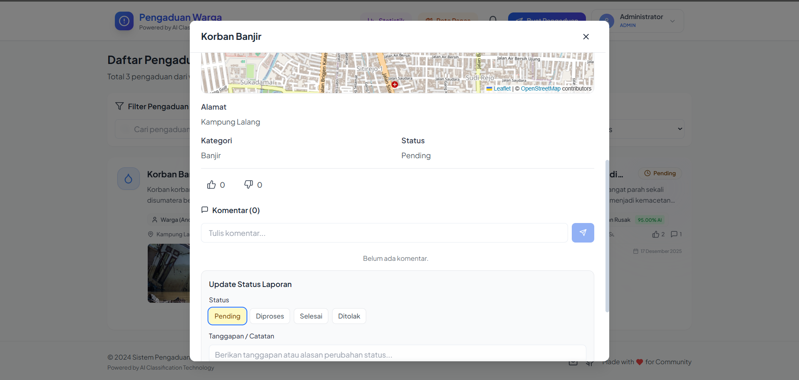
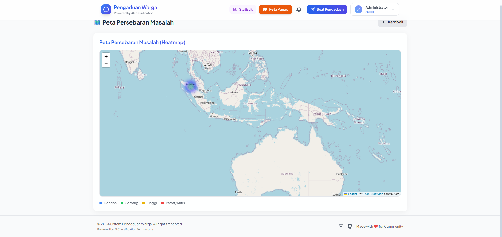

# Sistem Pengaduan Warga (SIPW)

Sistem Informasi Pengaduan Warga modern dengan antarmuka **Premium Glassmorphism**, klasifikasi otomatis berbasis AI, dan visualisasi data **Heatmap**. Aplikasi ini memudahkan warga melaporkan masalah lingkungan (sampah, jalan rusak, banjir, dll) secara transparan dan responsif.


## 🚀 Fitur Unggulan

### 🌟 User Experience (Warga)
- **Civic UI (Taste Skill)**: Desain utilitas publik yang bersih, profesional, modern, bebas gradien berlebihan, dengan kontras keterbacaan tinggi.
- **Timeline Kronologis Transparan**: Rekam jejak lengkap dari pelaporan, verifikasi, penugasan dinas, catatan perkembangan berkala, hingga bukti foto tindakan penyelesaian.
- **Laporan Anonim Terlindungi**: Opsi anonim menjaga kerahasiaan identitas pelapor baik pada kartu laporan maupun jejak kronologi timeline.
- **Pilihan Urgensi & Estimasi SLA**: Warga dapat melihat estimasi batas waktu penanganan secara transparan (24j - 120j).
- **Pembukaan Kembali Laporan**: Warga dapat membuka kembali laporan yang selesai jika permasalahan di lapangan belum tuntas.
- **Lokasi Presisi & Bukti Foto**: Pinpoint peta interaktif (Leaflet) dan upload foto kejadian dengan preview instan.

### 🛡️ Dashboard Operasional (Admin, Supervisor, & Petugas)
- **SLA & Eskalasi Otomatis**: Sistem penghitungan batas waktu penanganan di backend dengan indikator aman, mendekati tenggat (< 12 jam), terlambat, dan auto-eskalasi ke Supervisor.
- **Manajemen Disposisi & OPD**: Antrean disposisi cepat ke OPD (DLH, PUPR, DISHUB, SATPOL PP, dll) dan petugas lapangan disertai indikator beban kerja aktif (*workload balancing*).
- **Tab Khusus Petugas ("Tugas Saya")**: Antarmuka terfokus bagi petugas untuk memperbarui progres penanganan, mencatat catatan internal/publik, dan mengunggah foto bukti penyelesaian.
- **Audit Trail Pemindahan**: Riwayat lengkap aktor, waktu, catatan pengalihan, dan mutasi tugas tanpa menghapus riwayat lama.
- **Heatmap Visual & Statistik**: Peta persebaran masalah lingkungan dan analitik kepatuhan SLA per departemen.

---

## 🛠️ Teknologi yang Digunakan

### Frontend
- **React 18** (Vite-based)
- **Tailwind CSS** (Styling & Responsive Design)
- **Framer Motion** & **Glass UI** (Animations & Effects)
- **React Leaflet** (Maps & Heatmap)
- **Lucide React** (Modern Icons)
- **Axios** (API Client)

### Backend
- **Node.js** & **Express** (REST API)
- **PostgreSQL** (Database Relasional)
- **Cloudinary** (Cloud Storage untuk Gambar)
- **JWT** (Secure Authentication)
- **Multer** (File Handling)

---

## 📋 Prasyarat Instalasi

Pastikan komputer Anda sudah terinstall:
- **Node.js** (v16+)
- **PostgreSQL** (v13+)
- **Git**

---

## ⚡ Panduan Instalasi Cepat

### 1. Clone Repository
```bash
git clone https://github.com/drexjgobgt/si-pengduan-warga.git
cd si-pengduan-warga
```

### 2. Konfigurasi Backend
Masuk ke folder backend dan install dependencies:
```bash
cd backend
npm install
```

Buat file `.env` di dalam folder `/backend`:
```env
PORT=5000
NODE_ENV=development

# Database Config
DB_HOST=localhost
DB_PORT=5432
DB_NAME=pengaduan_warga
DB_USER=postgres
DB_PASSWORD=password_db_anda

# Authentication
JWT_SECRET=rahasia_super_secure_bisa_diganti

# Cloudinary (Untuk Upload Gambar)
CLOUDINARY_CLOUD_NAME=nama_cloud_anda
CLOUDINARY_API_KEY=api_key_anda
CLOUDINARY_API_SECRET=api_secret_anda

# Email Service (Opsional - SMTP Gmail)
EMAIL_HOST=smtp.gmail.com
EMAIL_PORT=587
EMAIL_USER=email_anda@gmail.com
EMAIL_PASS=app_password_gmail
```

**Setup Database & Migrasi:**
Jalankan migrasi database otomatis (Pastikan PostgreSQL sudah berjalan):
```bash
# Jalankan runner migrasi otomatis (mencakup upload, reset password, SLA, OPD & disposisi)
node database/migrations/run-migration.js
```

Jalankan Server:
```bash
npm run dev
# Server berjalan di: http://localhost:5000
```

### 3. Konfigurasi Frontend
Buka terminal baru, masuk ke folder frontend:
```bash
cd ../frontend
npm install
```

Buat file `.env` di dalam folder `/frontend`:
```env
REACT_APP_API_URL=http://localhost:5000/api
```

Jalankan Aplikasi:
```bash
npm run dev
# Akses aplikasi di: http://localhost:3000
```

---

## 📸 Screenshots

| Dashboard Utama | Detail Laporan (Map & Chart) |
|:---:|:---:|
|  |  |

| Heatmap Wilayah (Admin) | Versi Mobile |
|:---:|:---:|
|  |  |

---

## 🔐 Akun Demo (Default)

| Role | Email | Password |
|:---|:---|:---|
| **Admin** | `admin@pengaduan.local` | `admin123` |
| **Petugas** | `petugas@pengaduan.local` | `admin123` |
| **Warga** | *(Silakan Register Sendiri)* | - |

---

## 👥 Kontribusi

Project ini dikembangkan untuk kebutuhan Open Source. Pull Request sangat dipersilakan!
1. Fork repo ini
2. Buat branch fitur (`git checkout -b fitur-keren`)
3. Commit perubahan (`git commit -m 'Menambah fitur keren'`)
4. Push ke branch (`git push origin fitur-keren`)
5. Buat Pull Request

---

**License**: MIT
**Author**: Drexjgobgt & Team
