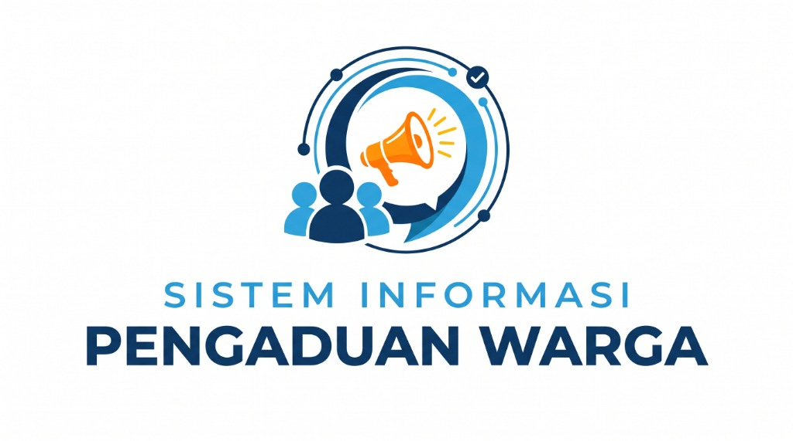
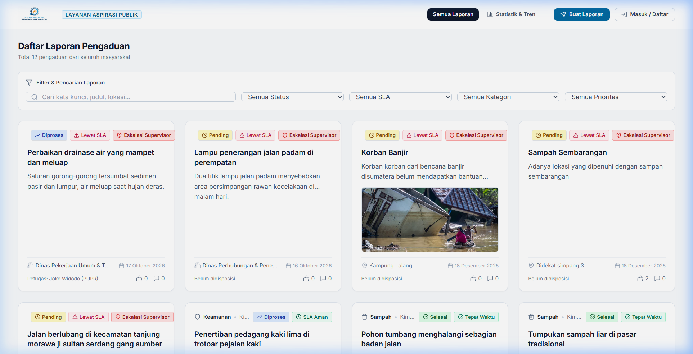
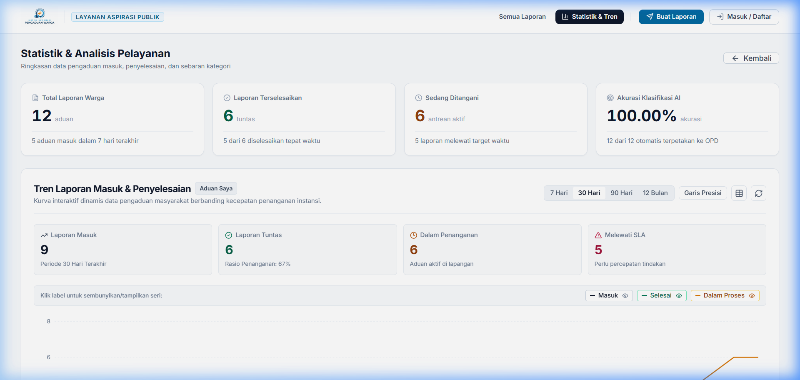
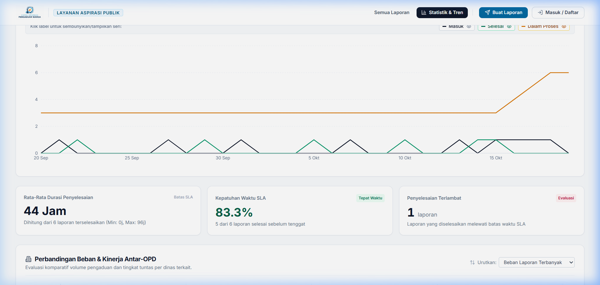
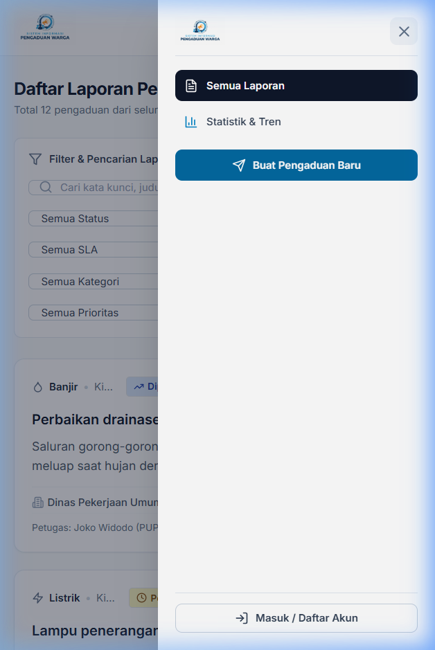

# Sistem Informasi Pengaduan Warga (SIPW)

<p align="center">
  
</p>

Sistem Informasi Pengaduan Warga (SIPW) adalah aplikasi web pelayanan publik untuk pelaporan, penelusuran status, disposisi tugas, dan pemantauan Service Level Agreement (SLA) penanganan masalah lingkungan perkotaan. 

Aplikasi ini menghubungkan masyarakat dengan instansi Organisasi Perangkat Daerah (OPD) seperti Dinas Lingkungan Hidup (DLH), Dinas Pekerjaan Umum (PUPR), Dinas Perhubungan (DISHUB), dan Satuan Polisi Pamong Praja (SATPOL PP).

---

## Pratinjau Antarmuka

### 1. Beranda & Daftar Laporan (Desktop Full-Width)
Tata letak fluid hingga lebar 1720px dengan pembagian kolom adaptif, baris filter terpadu, dan kartu laporan yang terstruktur rapi.



### 2. Statistik & Tren Interaktif
Grafik linier formal berbasis Recharts untuk memantau volume aduan masuk, laporan selesai, antrean proses, dan keterlambatan SLA dengan rentang waktu 7 hari hingga 12 bulan.



### 3. Kinerja Penanganan & Komparasi Antar-OPD
Metrik rata-rata durasi penyelesaian (jam), rasio kepatuhan target SLA, serta diagram batang horizontal yang dapat diurutkan berdasarkan beban kerja atau tingkat ketuntasan.



### 4. Tampilan Mobile & Drawer Navigasi
Dioptimalkan untuk layar ponsel (320px–430px) tanpa pergeseran horizontal (*zero overflow*), dilengkapi menu drawer samping dan kontrol formulir yang mudah disentuh.



---

## Fitur Utama

### Pelayanan Publik (Warga)
- **Pelaporan Berbasis Peta & Bukti**: Penandaan titik lokasi dengan peta interaktif (Leaflet), alamat otomatis, dan unggah foto lampiran.
- **Opsi Pelapor Anonim**: Melindungi identitas pelapor pada kartu laporan publik dan linimasa penanganan.
- **Linimasa Kronologis**: Riwayat tahapan dari pelaporan, verifikasi, penugasan petugas, hingga bukti foto tindakan selesai.
- **Keterbukaan SLA**: Menampilkan estimasi batas waktu penanganan secara transparan (24 jam hingga 120 jam sesuai tingkat urgensi).
- **Pembukaan Kembali Laporan**: Warga dapat mengajukan pembukaan kembali jika kendala di lapangan belum tuntas.

### Manajemen Operasional & Penugasan (Admin & Petugas)
- **Pemantauan Batas Waktu SLA**: Klasifikasi otomatis status tenggat (*Aman*, *Mendekati Batas < 12 jam*, *Melewati SLA*, dan *Eskalasi Supervisor*).
- **Disposisi Cepat ke OPD & Petugas**: Penugasan laporan ke dinas terkait dan petugas lapangan disertai pemantauan beban kerja aktif.
- **Tab Khusus Petugas ("Tugas Saya")**: Antarmuka kerja bagi petugas untuk memperbarui progres, mencatat tindakan lapangan, dan mengunggah foto bukti penyelesaian.
- **Audit Trail Pengalihan**: Pencatatan riwayat perpindahan tugas dan catatan internal antar-petugas.

### Analisis Data & Aksesibilitas
- **Grafik Tren Garis Linier**: Pilihan rentang waktu (7 Hari, 30 Hari, 90 Hari, 12 Bulan) dan opsi toggle kurva interpolasi halus vs garis linier presisi.
- **Tabel Data Alternatif**: Mode tabel data terstruktur untuk pembaca layar (*screen reader*) sesuai standar aksesibilitas WCAG 2.1 AA.
- **Peta Kepadatan Spasial (Heatmap)**: Pemetaan sebaran konsentrasi masalah lingkungan di seluruh wilayah administratif.

---

## Tumpukan Teknologi

### Frontend
- **React 18** (`react-scripts`)
- **Tailwind CSS 3** (Sistem token warna *Civic Navy*, *Azure*, dan semantik status)
- **Recharts 2.15** (Visualisasi data analitik)
- **React Leaflet & Leaflet** (Peta spasial dan geolokasi)
- **Lucide React** (Ikon antarmuka)
- **Axios** (Klien HTTP API)

### Backend
- **Node.js** & **Express.js** (REST API)
- **PostgreSQL** (Database relasional dengan agregasi SQL kontinu `generate_series`)
- **JSON Web Token (JWT)** & **Bcrypt** (Autentikasi dan otorisasi role)
- **Multer** & **Cloudinary** (Manajemen berkas dan foto lampiran)

---

## Persyaratan Sistem

Pastikan perangkat telah terpasang:
- **Node.js** (versi 16 atau lebih baru)
- **PostgreSQL** (versi 13 atau lebih baru)
- **Git**

---

## Panduan Instalasi & Menjalankan Aplikasi

### 1. Salin Repositori
```bash
git clone https://github.com/drexjgobgt/si-pengduan-warga.git
cd si-pengduan-warga
```

### 2. Konfigurasi Backend
Masuk ke direktori backend dan instal dependensi:
```bash
cd backend
npm install
```

Buat file konfigurasi `.env` di dalam folder `/backend`:
```env
PORT=5000
NODE_ENV=development

# Konfigurasi Database PostgreSQL
DB_HOST=localhost
DB_PORT=5432
DB_NAME=pengaduan_warga
DB_USER=postgres
DB_PASSWORD=password_database_anda

# Autentikasi
JWT_SECRET=kunci_rahasia_jwt_anda

# Penyimpanan Cloudinary (Foto Lampiran)
CLOUDINARY_CLOUD_NAME=cloud_name_anda
CLOUDINARY_API_KEY=api_key_anda
CLOUDINARY_API_SECRET=api_secret_anda

# Layanan Notifikasi Email (Opsional)
EMAIL_HOST=smtp.gmail.com
EMAIL_PORT=587
EMAIL_USER=email_anda@gmail.com
EMAIL_PASS=app_password_anda
```

Jalankan skrip migrasi database:
```bash
node database/migrations/run-migration.js
```

Jalankan server backend:
```bash
npm run dev
# Server aktif pada port: http://localhost:5000
```

### 3. Konfigurasi Frontend
Buka terminal baru, masuk ke direktori frontend, lalu pasang dependensi:
```bash
cd ../frontend
npm install
```

Buat file `.env` di dalam folder `/frontend`:
```env
REACT_APP_API_URL=http://localhost:5000/api
```

Jalankan aplikasi React:
```bash
npm start
# Antarmuka web dapat diakses di: http://localhost:3000
```

Untuk membangun versi produksi:
```bash
npm run build
```

---

## Integrasi Kecerdasan Buatan (Kios API)

SIPW menggunakan **Kios API** (`https://api.kiosapi.id/v1`), gateway API kompatibel dengan spesifikasi OpenAI standar, untuk menyediakan dua kapabilitas AI mandiri:

### 1. Layanan Klasifikasi Pengaduan (Real LLM)
- Menggantikan sistem pencocokan kata kunci (*keyword matching*) sebagai mekanisme utama.
- Menganalisis judul dan deskripsi laporan dalam bahasa Indonesia sehari-hari, salah ketik, kalimat panjang, konteks ambigu, dan laporan majemuk.
- Menghasilkan rekomendasi terstruktur: `category`, `secondaryCategories`, `suggestedDepartment`, `suggestedPriority`, `reason`, `confidence`, dan `needsHumanReview`.
- **Validasi Ketat**: Kategori dan departemen divalidasi terhadap database aktif; kategori/departemen fiktif hasil halusinasi model otomatis dialihkan ke `lainnya` / `KELURAHAN` dan ditandai untuk peninjauan petugas (`needsHumanReview = true`).
- **Resiliensi Pengaduan**: Jika layanan AI mengalami kendala jaringan atau batas kuota habis, pengaduan warga **tetap berhasil disimpan** dengan penandaan verifikasi manual petugas tanpa mematikan alur operasional.

### 2. Layanan Chatbot Warga (Citizen AI Chatbot)
- **FAQ Publik Terbuka**: Pengunjung umum (tanpa login) dapat menanyakan alur pelaporan, 9 kategori resmi, penjelasan status, batas waktu SLA, pelaporan anonim, dan bantuan umum.
- **Pelacakan Laporan Terotorisasi**: Pertanyaan seperti *"Bagaimana status laporan saya?"* memerlukan login (JWT). Sistem memverifikasi identitas pengguna di backend dan hanya menyajikan ringkasan laporan milik warga yang bersangkutan (tanpa catatan rahasia internal petugas atau data warga lain).
- **Pertahanan Prompt Injection**: Prompt sistem dirancang ketat untuk menolak instruksi manipulatif, permintaan kode berbahaya, atau upaya membocorkan kredensial.
- **Privasi Sesi**: Sesi obrolan bersifat temporer, ringan, dan tidak menyimpan data percakapan yang tidak perlu.

### 3. Kebijakan "Gratis Saja" (*Free-Only Policy*)
SIPW dirancang untuk beroperasi tanpa biaya API tak terkendali:
- `KIOSAPI_FREE_ONLY=true` (wajib aktif): Mencegah fallback otomatis ke model berbayar.
- Model default menggunakan tier gratis (misalnya: `meta-llama/llama-3.2-3b-instruct:free`, `google/gemini-2.0-flash-exp:free`, `qwen/qwen-2.5-7b-instruct:free`).
- Pembatasan kuota request harian lokal (`KIOSAPI_DAILY_REQUEST_LIMIT=200`).
- Pembatasan panjang input (maks 500 karakter per pesan) dan batas token respon.
- Rate limiting 25 request/menit per alamat IP pada endpoint `/api/chat`.
- Kredensial rahasia (`KIOSAPI_API_KEY`) hanya disimpan di lingkungan backend `.env` dan **tidak pernah dikirim ke frontend, respons API, atau log**.

### 4. Daftar Environment Variable Kios API (Backend)
Tambahkan ke file `backend/.env`:
```env
# Kios API Key dari dashboard https://api.kiosapi.id
KIOSAPI_API_KEY=kios_live_xxxxxx

# Base URL provider
KIOSAPI_BASE_URL=https://api.kiosapi.id/v1

# Model untuk klasifikasi laporan
KIOSAPI_CLASSIFICATION_MODEL=meta-llama/llama-3.2-3b-instruct:free

# Model untuk chatbot interaktif warga
KIOSAPI_CHAT_MODEL=meta-llama/llama-3.2-3b-instruct:free

# Kebijakan gratis saja (true / false)
KIOSAPI_FREE_ONLY=true

# Batas kuota request lokal per hari
KIOSAPI_DAILY_REQUEST_LIMIT=200

# Batas waktu panggilan API (milidetik)
KIOSAPI_REQUEST_TIMEOUT_MS=15000

# Batas token keluaran
KIOSAPI_CLASSIFICATION_MAX_TOKENS=500
KIOSAPI_CHAT_MAX_TOKENS=600
```

---

## Pengujian Otomatis

SIPW menyediakan rangkaian uji unit (*unit test suite*) bawaan Node.js untuk memverifikasi logika AI, validasi model, privasi pelacakan, dan keamanan:

```bash
cd backend
npm test
```

Rangkaian pengujian mencakup 17 skenario:
- Pemanggilan Kios API dan penegakan kebijakan Free-Only.
- Sanitasi API key agar tidak bocor ke log atau pesan galat.
- Parsing dan validasi keluaran terstruktur model klasifikasi.
- Penanganan kategori fiktif dan ambang batas keyakinan (*confidence threshold*).
- Penanganan kegagalan provider tanpa mengorbankan penyimpanan aduan warga.
- Aksesibilitas FAQ publik tanpa login.
- Penolakan pelacakan pengaduan pribadi bagi pengunjung anonim.
- Pembatasan data pelacakan hanya untuk pemilik sah laporan.
- Pembatasan ukuran pesan dan penolakan prompt injection.

---

## Akun Demo Bawaan

| Peran | Alamat Email | Kata Sandi | Akses Utama |
|:---|:---|:---|:---|
| **Admin** | `admin@pengaduan.local` | `admin123` | Seluruh dashboard, disposisi OPD, analitik kinerja |
| **Petugas** | `petugas@pengaduan.local` | `admin123` | Tab Tugas Saya, pembaruan status, unggah bukti |
| **Supervisor** | `supervisor@pengaduan.local` | `admin123` | Eskalasi aduan lewat batas waktu, rekapitulasi SLA |
| **Warga** | `rafifnyantuy@gmail.com` | *(akun warga terdaftar)* | Pelaporan aduan, pelacakan linimasa, chatbot asisten |

---

## Lisensi

Proyek ini dirilis di bawah lisensi [MIT](LICENSE).
